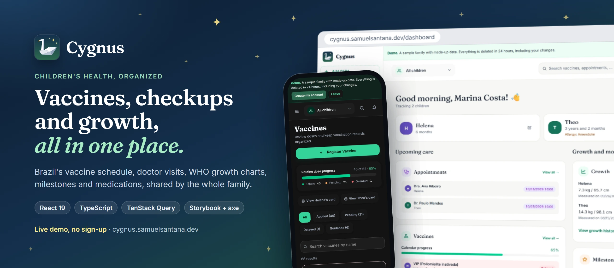
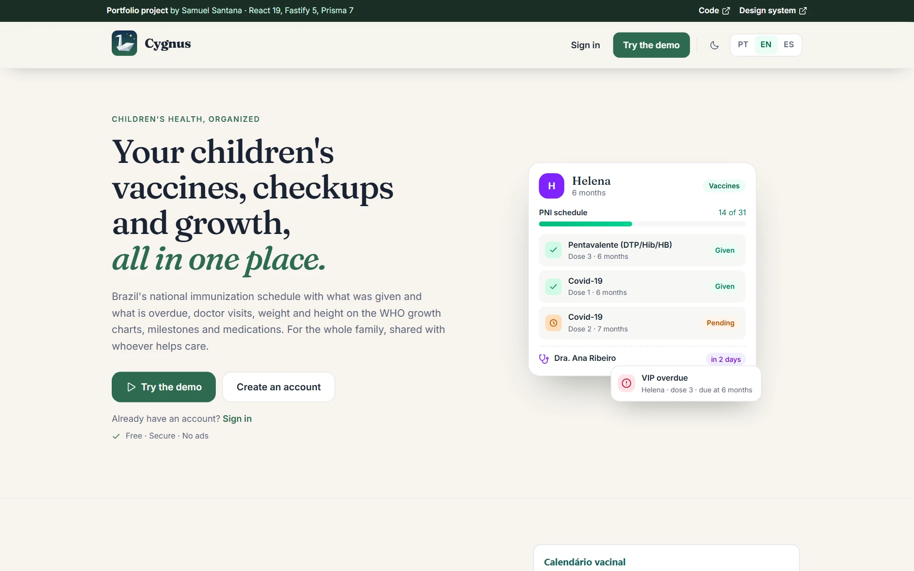
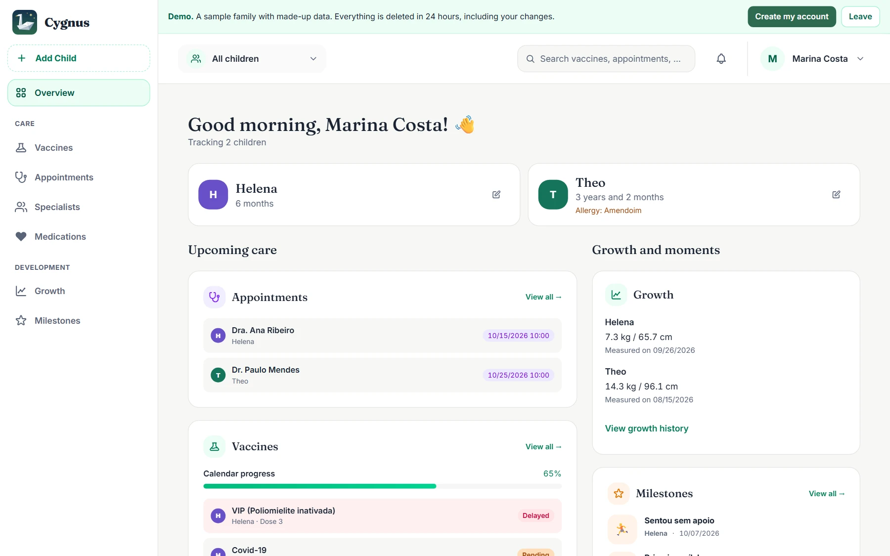
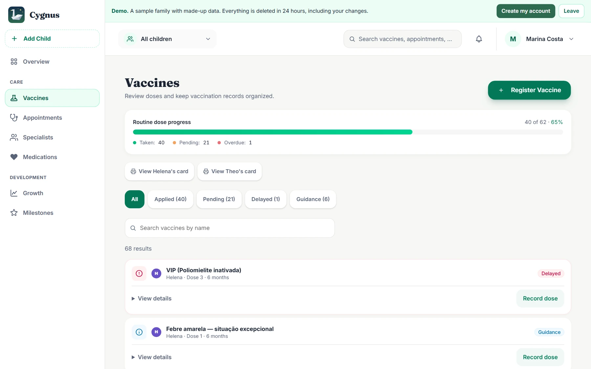
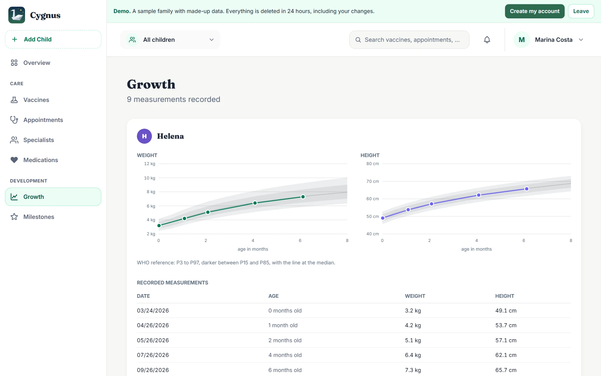
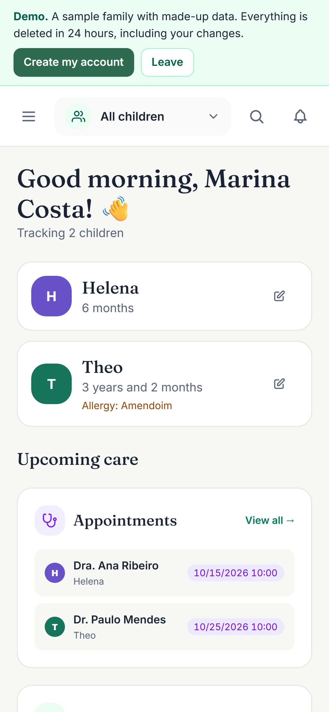
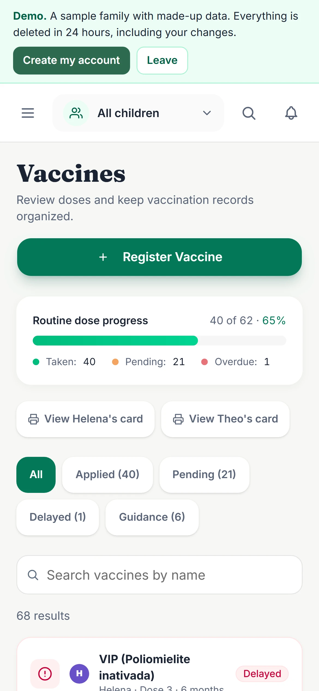
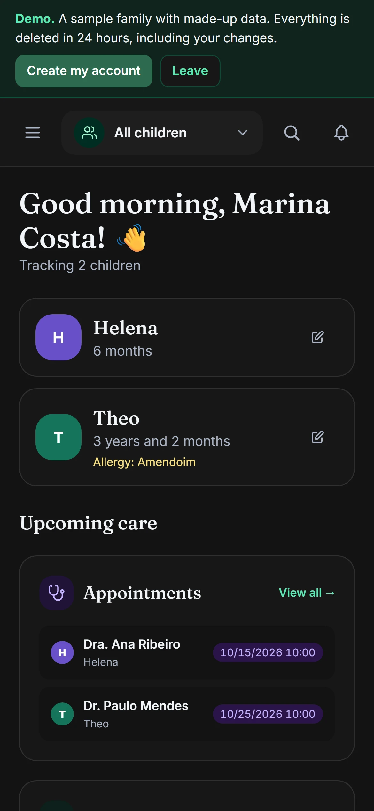
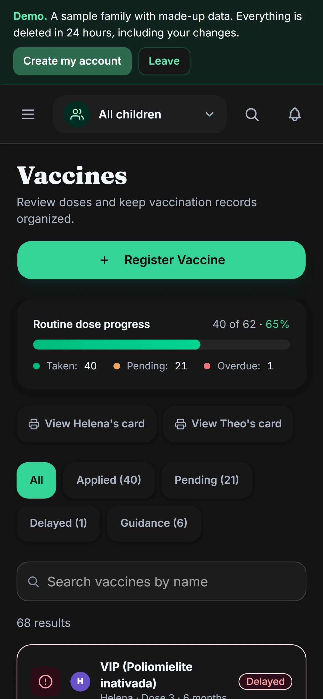
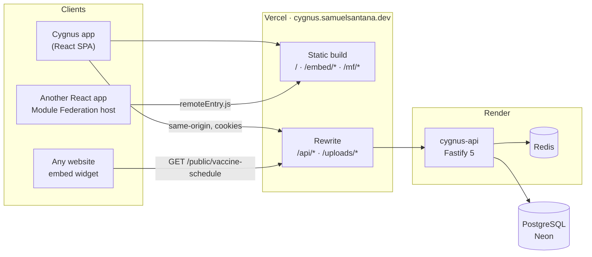

<a href="https://cygnus.samuelsantana.dev"></a>

<p align="center">
  <a href="https://cygnus.samuelsantana.dev"><b>Try the live demo</b></a>: no sign-up, a sample family that is deleted after 24 hours.
  <br>
  <a href="https://samuelcsantana.github.io/cygnus/">Design system</a> ·
  <a href="https://github.com/samuelcsantana/cygnus-api">API repository</a> ·
  <a href="https://samuelcsantana.github.io/cygnus/coverage/">Coverage report</a> ·
  <a href="https://github.com/samuelcsantana/cygnus/releases/latest">Releases</a>
</p>

<p align="center">
  <a href="https://github.com/samuelcsantana/cygnus/actions/workflows/ci.yml"></a>
  <a href="https://samuelcsantana.github.io/cygnus/"></a>
  <a href="https://samuelcsantana.github.io/cygnus/coverage/"></a>
  <a href="https://github.com/samuelcsantana/cygnus/releases/latest"></a>
  <a href="LICENSE"></a>
</p>

# Cygnus

Cygnus is a mobile-first web app where parents keep their children's health record in one place:
Brazil's National Immunization Program (PNI) schedule, with what was given and what is overdue;
doctor visits; weight and height on the WHO growth charts; developmental milestones with photos;
medications, professionals and health plans. A record can be shared with every person who helps
care, so it does not live in one parent's drawer. Portuguese, English and Spanish; light and dark.

This repository is the frontend. The backend is
[cygnus-api](https://github.com/samuelcsantana/cygnus-api). Both are a portfolio project, built
the way a product is built: tests, an accessible design system, a public contract between the two
halves, production deploys, privacy terms and observability.

Cygnus organizes information. It does not replace advice from healthcare professionals.

## Screens

Taken from the live demo by [`scripts/render-readme-assets.mjs`](scripts/render-readme-assets.mjs).
They follow your GitHub theme.

<table>
  <tr>
    <td width="50%">
      <picture>
        <source media="(prefers-color-scheme: dark)" srcset=".github/assets/screens/landing-dark.webp">
        
      </picture>
      <p align="center"><b>Landing page</b>, which never waits for the API</p>
    </td>
    <td width="50%">
      <picture>
        <source media="(prefers-color-scheme: dark)" srcset=".github/assets/screens/dashboard-dark.webp">
        
      </picture>
      <p align="center"><b>Dashboard</b> for the whole family</p>
    </td>
  </tr>
  <tr>
    <td width="50%">
      <picture>
        <source media="(prefers-color-scheme: dark)" srcset=".github/assets/screens/vaccines-dark.webp">
        
      </picture>
      <p align="center"><b>Vaccines</b> on the PNI schedule</p>
    </td>
    <td width="50%">
      <picture>
        <source media="(prefers-color-scheme: dark)" srcset=".github/assets/screens/growth-dark.webp">
        
      </picture>
      <p align="center"><b>Growth</b> over the WHO reference bands</p>
    </td>
  </tr>
</table>

<p align="center">
  
  
  
  
</p>

## What is worth reading here

The decisions below are the ones a reviewer would ask about. Each names the file where it lives.

- **No token ever reaches JavaScript.** Sessions are HttpOnly, `SameSite=Strict` cookies. Concurrent
  401s share one silent `POST /auth/refresh` and retry once, and mutating requests echo the readable
  `csrf_token` cookie as `X-CSRF-Token` (double-submit). All three live in
  [`src/lib/http-client.ts`](src/lib/http-client.ts) and nowhere else. Strict cookies do not travel
  to a cross-site host, so production calls the API through a same-origin Vercel rewrite
  ([`vercel.json`](vercel.json)).
- **Every response is parsed at the boundary.** Each `*.api.ts` fetches `unknown` and returns a
  Zod-parsed type, so a contract drift surfaces as a validation error with a path, not as a broken
  render three components later. In CI, `npm run contract:check` compares the mapped schemas with
  the `openapi.json` the API commits ([`scripts/`](scripts)).
- **Accessibility is a build gate, not a panel.** Every Storybook story runs axe in the light and
  the dark theme, and a violation fails CI. There is no exception list. Four colour tokens in
  [`src/index.css`](src/index.css) deliberately differ from the design reference, because the
  reference values measured below WCAG AA; each says so where it is defined.
- **The landing page never waits for the API.** The API runs on a free Render instance that sleeps
  and takes about a minute to wake. The session cookies are HttpOnly, so the readable `csrf_token`
  cookie is the hint: without it, `/` renders at once and sends no request
  ([`LandingRoute.tsx`](src/features/landing/routes/LandingRoute.tsx)).
- **A demo without sign-up.** "Try the demo" asks the API for a disposable account, pre-filled with
  a sample family and deleted after 24 hours. The demo skips the terms gate, and a banner says the
  data is fake and how to leave.
- **The schedule also ships outside the app.** [`embed/`](embed/README.md) is a dependency-free web
  component in a shadow root, 2.78 kB gzip, with an iframe variant and a versioned `postMessage`
  protocol. [`mf/`](mf/README.md) exposes the same schedule as a Module Federation remote that shares
  the host's React as a singleton. Both are published contracts with stable URLs.
- **Dates are calendar dates.** A `YYYY-MM-DD` birth date is not a UTC instant. Vitest runs in
  `America/Sao_Paulo`, because in UTC (the CI default) that class of bug passes silently
  ([`src/lib/date.ts`](src/lib/date.ts)).
- **Motion that respects the reader.** Page changes are View Transitions, and the scroll-driven
  effects sit behind `@supports (animation-timeline: view())`. Every effect is off under
  `prefers-reduced-motion`.

## Architecture



The browser only ever talks to `cygnus.samuelsantana.dev`. GitHub Pages hosts the
[design system](https://samuelcsantana.github.io/cygnus/) and the
[coverage report](https://samuelcsantana.github.io/cygnus/coverage/), and Sentry receives errors
and Web Vitals.

## Stack

| Concern | Choice |
| --- | --- |
| UI | React 19, React Router 7, Tailwind CSS 4, shadcn/ui on Radix |
| Server state | TanStack Query, with exported query-key factories |
| Forms and validation | React Hook Form and Zod |
| UI state | Zustand, for UI state only |
| Localization | i18next: Brazilian Portuguese (default), English, Spanish |
| Build | Vite 8, strict TypeScript, oxlint, Module Federation |
| Tests | Vitest, Testing Library and MSW; Storybook 10 with axe; Playwright |
| Delivery | Vercel, GitHub Pages, Docker with nginx, Sentry |

## Running locally

Use Node.js 24 and npm. Start the [API](https://github.com/samuelcsantana/cygnus-api) first; it
listens on `http://localhost:3005` by default.

```bash
npm ci
npm run dev        # http://localhost:4205
```

To point at another API, create `.env.local` with `VITE_API_BASE_URL`. Every `VITE_*` variable is
compiled into the public bundle, so never put a secret in one; the Google credentials belong to the
API.

With Docker, nginx serves the production build on the same port, without hot reload:

```bash
docker compose up -d --build web
```

Rebuild after each change. Docker and Vite both use port 4205, so run one at a time. Compose does
not start the API; pass `VITE_API_BASE_URL` as a build argument to change its origin.

## Quality checks

| Command | What it checks |
| --- | --- |
| `npm run lint` | oxlint |
| `npx tsc -b` | Types for the app, stories, embed and Module Federation |
| `npm test` | Unit and component tests in jsdom, with strict MSW |
| `npm run test:coverage` | The same, with V8 coverage and a summary |
| `npm run contract:check` | Mapped schemas against the API's published OpenAPI |
| `npm run test:storybook` | Every story in Chromium: render, interactions and axe |
| `npm run test:e2e` | Playwright journeys against a running stack |
| `npm run build` | Typecheck, then the app, the embed and the remote, in that order |

CI runs lint, types, the contract check, coverage and the build in one job, and the Storybook suite
in another. The Storybook suite needs `npx playwright install chromium`. The E2E suite is not in CI,
because it needs a checkout of the API with PostgreSQL and Redis; the
[E2E instructions](e2e/README.md) explain how to run it. The contract check covers an explicit map
of endpoints, and axe does not replace a manual accessibility review.

The [coverage report](https://samuelcsantana.github.io/cygnus/coverage/) counts every TypeScript
module in `src/`, `embed/` and `mf/`, imported by a test or not, and excludes declarations, tests,
stories and test infrastructure. Storybook and E2E runs do not add to it. No minimum is enforced.

## Project layout

| Path | What lives there |
| --- | --- |
| `src/app/` | Router, providers, layouts and the session gate |
| `src/features/<domain>/` | One folder per domain: `api/` (fetch, Zod schemas, hooks), `components/`, `routes/` |
| `src/components/ui/` | shadcn/ui primitives, without business logic |
| `src/shared/`, `src/hooks/`, `src/lib/` | Cross-feature components and infrastructure: HTTP client, query client, i18n, dates |
| `src/locales/` | Copy in the three languages |
| `src/docs/` | Storybook pages |
| `embed/`, `mf/` | The widget and the federated remote |
| `e2e/` | Playwright journeys |

Routes are lazy-loaded. Design tokens live in `src/index.css`, and stories sit beside their
components.

## Deployment

A merge to `main` deploys to Vercel and republishes the design system and the coverage report to
GitHub Pages. One build produces three artifacts:

| Artifact | Public entry point | Notes |
| --- | --- | --- |
| The app | `/` | lazy routes; entry chunk 183.8 kB gzip |
| Embed widget | `/embed/embed.js`, `/embed/iframe.html` | [embed/README.md](embed/README.md) |
| Module Federation remote | `/mf/remoteEntry.js` | [mf/README.md](mf/README.md) |

Those three URLs are contracts: they live in other people's HTML and deployments, so they never
change, and they are cached for ten minutes. Only hashed assets are `immutable`. Vercel and the
Docker nginx keep separate header configurations, and one script checks either:

```bash
node scripts/check-static-serving.mjs            # headers, caching and 404s
node scripts/check-static-serving.mjs --browser  # plus the iframe, from another origin, in Chromium
```

It checks the Docker build on port 4205 by default; set `STATIC_BASE_URL` to check another target.
The browser check calls the real API.

## Terms and privacy

The [Terms of Use](https://cygnus.samuelsantana.dev/termos) and the
[Privacy Policy](https://cygnus.samuelsantana.dev/privacidade) are versioned in
[`src/shared/legal.ts`](src/shared/legal.ts), with the text in `src/features/legal/content/`. A new
version asks every signed-in user to accept again, and the API records each acceptance.

## License

[MIT](LICENSE), © 2026 Samuel Santana. Dependencies and third-party material keep their own
licenses.

Built by Samuel Santana: [samuel.ssa89@gmail.com](mailto:samuel.ssa89@gmail.com).
